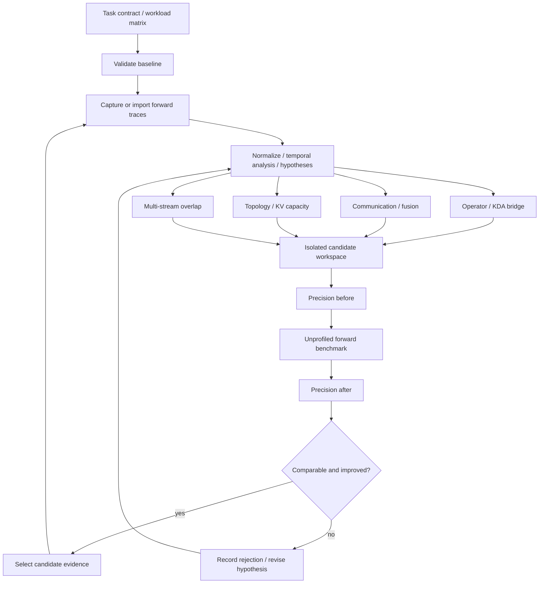

# 架构与边界

## 优化单位

一个 campaign 固定模型、权重、镜像、输入分布、forward 边界和验收条件。
一个 iteration 研究一个瓶颈假设，产生候选 patch 和完整证据。
一个 evidence bundle 表示一个 revision 在全部测试条件下的报告与 trace。
只有验收通过的候选证据才能成为下一轮比较基线；production 的替换属于另一个流程。



图中 capture、候选实现与真实验证器属于目标架构；v0.1 读取它们的已生成产物。
`engine.replay` 是单进程、串行、有限预算的编排器，没有隐藏的后台 daemon 或 LLM 调用。
流式表示阶段事件随发生写入 JSONL 并刷新 stdout，不表示 token streaming 或实时 profiler。

## 控制面与执行面

| 层 | 当前模块 | 职责 |
| --- | --- | --- |
| Contract | contracts.py | 显式标记 schema、环境、workload、precision、benchmark 和 trace |
| Trace | trace.py | 仅导入 complete events；按单 forward 窗口裁剪 |
| Analysis | analysis.py | 每个 rank/device 的时间并集与热点；输出待检验任务 |
| Evaluation | evaluation.py | 可比性、完整性、精度顺序、噪声和逐条件双指标门禁 |
| Orchestration | engine.py | 导入、分析、决策、推进基线、重复分析、终止 |
| Storage | store.py | 原始产物快照、SHA256 清单、事件和报告 |
| Execution plugins | adapters/protocols.py | 预留真实 profiler、优化器和执行器接口 |

后续扩展通过 Python Protocol 注入，不在 CLI 内堆叠 CUDA/MUSA/框架分支。
Profiler 负责采集和转换，Executor 负责资源与执行，Optimizer 负责可审查计划和 patch。
LLM 只能提出实验；确定性的验证器拥有是否选择候选的决定权。

## 当前状态流

```text
run_started
  → snapshot baseline → validate baseline → analyze baseline → tasks.000
  → [snapshot candidate → validate/compare
       → accepted: analyze candidate → save decision → advance baseline
       → rejected: save decision, retain current baseline] × max_iterations
  → summary + report → run_completed
```

输入损坏、采集缺失、重复 rank trace 或运行时异常会记录 `run_failed` 并停止；
未通过精度、可比性或性能验收的完整候选记录淘汰后继续。
若通过性能门禁却无法分析 trace，整个 run 失败，候选不会前进为基线。
v0.1 不支持崩溃续跑、多个写入者、自动恢复、生产部署或改变拓扑后的自动比较。
已有输出目录一律拒绝覆盖。停止原因区分预算耗尽与候选耗尽。

## 时间分析的定义

在 rank r、device d 的 forward 窗口 W 内，把 GPU 事件裁剪为区间。
令 C、N、M 分别为计算、通信、内存事件区间的并集：

- busy = |C ∪ N ∪ M|；idle = |W| − busy。
- compute/communication overlap = |C ∩ N| = |C| + |N| − |C ∪ N|。
- communication without compute = |N| − |C ∩ N|。
- hotspot work = 同名事件 duration 之和，不去除其他 Stream 的重叠。

所有区间运算在单个 rank/device 上进行，绝不把多卡时间累加成 forward 延迟。
跨 host 时钟无需对齐；这也意味着无法由这些指标给出全局关键路径。
完整归因还需要 launch correlation、stream/event、collective、跨 rank 依赖与 CPU 调度。
缺少这些证据时只输出假设，不输出“根因已确认”。

## 扩展顺序

先接入一个真实的 forward runner，确立边界与精度验证；再接 profiler；最后接 coding agent。
KDA 接收某个已定位热点的局部契约；候选必须回到整段 forward 中复验。
分布式探索需要新版本的比较契约，固定物理资源与业务负载，明确允许变动的拓扑轴；
当前严格环境匹配会拒绝拓扑不同的证据，避免提前给出不公平的分布式收益。
