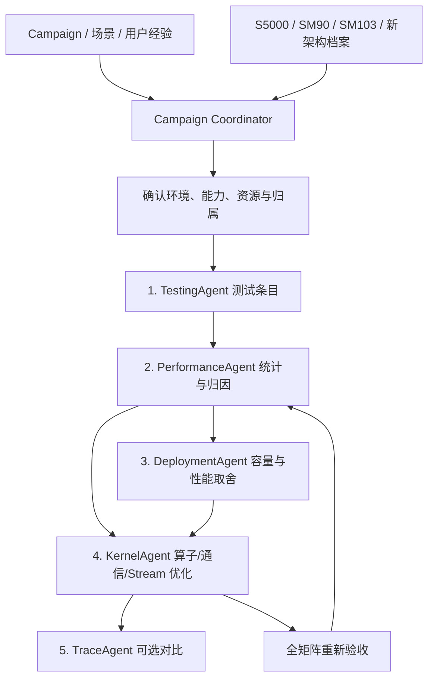

# 多架构综合 Agent 框架

项目目标是一个覆盖服务测试、forward 性能分析、分布式取舍、算子优化与 trace 对比的综合 Agent。
当前实现了五模块的规划总控，以及既有证据的 replay 验收。真实执行器和领域策略逐项展开。
`agents` 表示逻辑职责，当前不是五个后台进程，也不会自动调用 LLM 或派发子代理。

## 总控与共享上下文



这是目标工作流。`ifa plan` 只生成依赖、有待补充的输入和预期输出，不执行图中的 GPU 操作。
第一轮 kernel 计划把部署/形状约束作为输入；后续可保持原放置，只优化热点。
拓扑候选和算子候选都必须重新回到 Testing/Performance 复验，再进入已有 evidence gate。
规划阶段没有真实 trace pair 时跳过 TraceAgent，不阻止测试、性能或算子模块继续设计。

## 五模块的边界

| 用户目标 | 代码模块 | 输入 | 输出契约 | 当前状态 |
| --- | --- | --- | --- | --- |
| 规范测试条目、服务多场景 | agents/testing.py + scenarios.py | suite、模型/镜像身份、reference、cache 准备 | 展开后的场景矩阵、覆盖与跳过原因、正确性/原始样本 | 矩阵展开与任务规划已实现；runner 待接入 |
| prefill forward、算子占比和性能 | agents/performance.py | service/forward/operator 原始样本、可选 trace/counters | 三层分离的统计、明确分母的算子占比、瓶颈假设 | 规划已实现；原 replay 时间分析保留；新聚合器待接入 |
| 分布式 Cache 容量或性能 | agents/deployment.py | 固定物理资源、拓扑、全 rank 显存与实测候选 | 可行性、容量/性能取舍表与 Pareto 候选 | 目标/约束接口已实现；选型与容量算法待接入 |
| 不同架构上的算子优化 | agents/kernel.py | 数学/数值契约、shape/路由、已核实 ISA 和资源 | 隔离 patch、算子证据、forward 复验请求 | 架构上下文与任务规划已实现；优化器待接入 |
| trace 对比与分析（如有） | agents/traces.py | 同架构、同场景/阶段的 before/after pair | forward/算子/通信/overlap 差异、瓶颈迁移 | pair 校验和可选阶段已实现；对比算法待接入 |

通信融合和多 Stream overlap 横跨 Performance、Deployment、Kernel、Trace 四个模块。
部署侧计入通信/overlap workspace；优化侧检查依赖与生命周期；分析侧验证完整 forward 收益。

## 多架构扩展

`architectures/registry.py` 提供注册表，内置三个独立档案：
`moore-s5000`、`nvidia-sm90`、`nvidia-sm103`。
档案位于 Python 包内的 `architectures/profiles/*.json`，随 wheel 分发。
旧 configs/backends 仍描述厂商后端的集成方向；新档案区分具体架构。

档案包含 vendor/runtime、能力、资源与必须核实的项目。当前没有填任何未经实测的峰值、
显存大小、寄存器/shared memory 数字，也不预设某条指令能在某个工具链中使用。
`planned` 只表示已登记目标，不表示已通过硬件验收。

新增架构：复制 templates/architecture/profile.json，给定唯一 id，
在 campaign 的 architecture_profiles 引用该文件，再把 id 加入 architectures。
无需修改总控代码。具体 ISA lowering、计数器、runner 和优化实现随后由 adapter 提供。
SM90 和 SM103 共享 CUDA 这个 runtime 身份，不共享未经核实的 kernel 合法性与最优策略。

## 用户控制的内容

- `configs/scenarios/baseline.json`：服务/forward/operator 的 scope、phase 与展开轴。
- `configs/campaigns/multi-architecture.json`：架构列表、部署目标、资源约束、可选 trace pair 和经验路径。
- `deployment.objective`：capacity / performance / balanced。当前仅记录规划目标，不会自动做部署。
- `playbooks`、`knowledge`：用户方法与实测案例。当前记录引用，尚无检索或自动执行规则。
- `agents/*.py`、`adapters/protocols.py`：后续逐模块接入策略与运行能力的位置。

所有路径相对 campaign JSON 所在目录解析。`max_scenarios` 当前实际限制矩阵展开规模；
budget、allowed_changes 等其余执行约束仅记录，未来 executor 接入时再强制执行。
示例模型和镜像为占位符，允许生成计划，但不构成可执行的真实任务。

## 指标与公平性

服务 TTFT/TPOT 与请求吞吐、prefill/decode forward、算子 microbenchmark 分开定义边界。
算子 work share 的默认规划分母为“所纳入 GPU 事件 duration 之和”；这与 forward 墙钟占比不同。
forward exposure 和因果关键路径仍需依赖证据，不能拿多 Stream 重叠的累计时间冒充。
具体指标、percentile、shape、数值标准由后续各模块说明进一步定稿。

分布式选择固定模型语义、输入分布、global workload、权重量化与物理资源预算。
容量包括 KV、recurrent state、权重、graph、workspace、碎片和峰值；未知项保持未知。
原 v1 replay 要求环境/拓扑完全一致，仍会拒绝拓扑改变的收益比较；本次没有放宽该门禁。
跨架构结果可作为单独的硬件对照研究，不能冒充同环境候选的优化收益。

## 规划产物

```text
campaign.plan.json       # 架构快照、五模块任务、依赖、缺证据和实现边界
scenario.matrix.json     # 规范化场景，不是测试结果
events.jsonl             # planning_started / stage_planned / planning_completed
plan.md                  # 可审查计划
```

输出目录必须不存在。`execution_ready=false` 表示尚未接入 runner，不能将规划完成当成测试完成。
